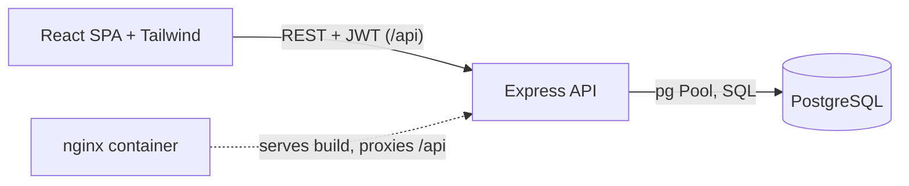
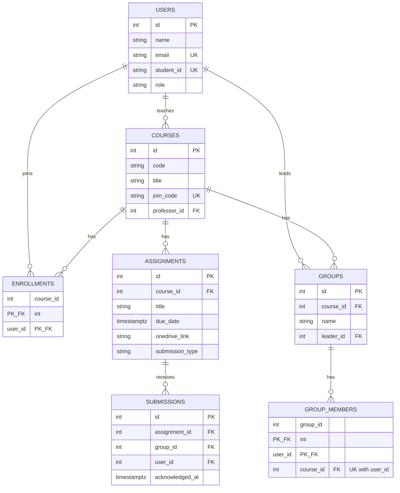

# Joineazy

Role-based full-stack app. Professors run courses and post assignments with OneDrive links. Students see their enrolled courses, open an assignment, and acknowledge their submission. Group assignments are acknowledged once, by the group leader, for every member.

**Stack:** React + Vite + Tailwind CSS, Node.js + Express, PostgreSQL, JWT auth, Docker.

## Setup

### Docker (recommended)
```bash
docker compose down -v      # only needed if you ran an earlier version: the schema changed
docker compose up --build
```
Open http://localhost:3000.

With `SEED_DEMO=true` (set in `docker-compose.yml`) the first start loads demo data: three courses, five students, two groups and six assignments.

| Role | Login | Password |
|---|---|---|
| Professor | `prof@joineazy.com` | `admin123` |
| Student, leader of Team Orbit | `aarav@joineazy.com` | `student123` |
| Student, member of Team Orbit | `diya@joineazy.com` or `kabir@joineazy.com` | `student123` |
| Student, leader of Team Vega | `meera@joineazy.com` | `student123` |

To see the group rule, open "Project proposal" in CS301 as Diya (button disabled, leader named), then acknowledge as Aarav in another browser. Diya's page updates by itself within a few seconds.

### Local
```bash
cd backend && cp .env.example .env && npm install && npm run dev   # needs a running Postgres
cd frontend && npm install && npm run dev                          # http://localhost:5173, /api proxied to :5000
```

## What was built

**Student dashboard** (`pages/StudentDashboard.jsx`): enrolled courses as cards in a responsive grid (1 column on phones, 2 on tablets, 3 on desktop). Each card shows the professor, an assignments-acknowledged progress bar and the next deadline or overdue count, and links to the course's assignment page. Students enrol with the join code a professor shares.

**Professor dashboard** (`pages/ProfessorDashboard.jsx`): an overview of students taught, assignments posted and a status bar across all courses (acknowledged, pending, overdue), then a grid of the courses they teach. Each card has student, assignment and group counts, a submission-status bar and the course join code.

**Assignment page** (`pages/CoursePage.jsx`): the course's assignments in a list on the left (a scrolling strip on mobile) and the selected assignment on the right.
- Details: title, description, deadline with a live "due in / overdue by" line, submission type (Individual or Group) and the OneDrive link.
- Status: a progress bar, a status message and an acknowledgement stamp that presses onto the page when the status changes. For group work the bar counts members covered. Animations respect `prefers-reduced-motion`.
- Feedback: status badges (Pending, Waiting for leader, Needs a group, Overdue, Acknowledged, Acknowledged late, Complete) are the same on every screen. When a submission is completed on screen, a checkmark draws itself, the progress bar fills, the stamp presses down and each covered member gets a tick. The same animations play on a member's page when the leader acknowledges.
- Group rule: only the leader sees an active "Acknowledge for my group" button. Everyone else sees it disabled with the leader's name. The acknowledgement is stored once for the group, so all members read the same row. Open pages poll every 8 seconds, so members see the change without reloading, with a short highlight.
- Professor view of the same page: progress against students (individual) or groups (group work), a roster of who has and has not acknowledged, groups not yet formed, and edit/delete.

## Architecture

Login returns a JWT, stored in localStorage and sent as `Authorization: Bearer`. Middleware verifies it and checks the role. The schema is created on backend start (`backend/db/schema.sql`), the professor is seeded from env vars, and demo data is seeded when `SEED_DEMO=true`.

## Database schema

`SUBMISSIONS` holds one row per acknowledgement. Individual work: `group_id` is null and `user_id` is the student, unique per (assignment, student). Group work: `group_id` is set and `user_id` is the leader who acknowledged, unique per (assignment, group). `GROUP_MEMBERS` repeats `course_id` so "one group per student per course" is a plain unique constraint.

### How the spec's "collections" map to this schema
The project uses PostgreSQL, so each collection is a table (or a view where it is a computed record). No data reset is needed for this part: indexes and views are created idempotently on start.

| Collection | Table / view | What it holds |
|---|---|---|
| Students | `students` view over `users` | Profile plus `enrolled_courses` (code, title, id) |
| Professors | `professors` view over `users` | Profile plus `courses_taught` |
| Courses | `courses` + `enrollments` | Course, its professor, and which students are enrolled |
| Assignments | `assignments` + `submissions`, read through the `assignment_student_status` view | Details and type (`individual` or `group`), the course they belong to, and a status for every enrolled student: `pending`, `acknowledged`, `overdue` or `no_group` |
| Groups | `groups` + `group_members` | The course, the `leader_id`, and a reference to each member student |

`assignment_student_status` returns one row per (assignment, student). For group work the status comes from the group's single submission row, so all members always agree. The professor's roster for individual assignments reads from it.

## Data relationships
Everything hangs off the course. Students reach assignments only through enrollment, groups live inside one course, and a submission points at an assignment plus either a student (individual work) or a group (group work).

```
users --< enrollments >-- courses --< assignments --< submissions
                            |                              |
                            +--< groups --< group_members  +-- group_id (group work) or user_id only (individual)
                                   |__ leader_id (always one of its members)
```

**Rules the database enforces itself** (foreign keys and one trigger, so they hold even if the API has a bug):

| Rule | Mechanism |
|---|---|
| A student is in at most one group per course | `UNIQUE (course_id, user_id)` on `group_members` |
| A group and its memberships belong to the same course | composite FK `(group_id, course_id)` to `groups (id, course_id)` |
| Only enrolled students can be in a group; un-enrolling removes them | composite FK `(course_id, user_id)` to `enrollments`, `ON DELETE CASCADE` |
| The leader is always a member of the group | deferred FK `groups (id, leader_id)` to `group_members`, checked at commit |
| One acknowledgement per student (individual) or per group (group work) | two partial unique indexes on `submissions` |
| Group work is acknowledged for a group of the same course by its current leader; individual work by an enrolled student, never by a group | `submissions_check` trigger |

**How group membership affects submissions.** A group's acknowledgement is one row, and each member's status is derived from the group they are in now:
- A student who joins a group is covered by every acknowledgement the group already has. The leader is told how many.
- A student who leaves or is removed stops being covered by them, and sees "Needs a group" on group assignments until they join another.
- Leadership can be handed to another member. Past acknowledgements stay credited to whoever made them, and only the new leader can acknowledge from then on.
- A leader cannot leave while others remain, and a group that has acknowledged anything cannot be dissolved, so the record is never lost.
- Each acknowledgement stores who made it, when, and `members_at_ack`, the group size at the time, so the professor can see exactly what was claimed.
- Deleting an assignment removes its acknowledgements. Individual and group acknowledgements never mix, because the assignment type is locked once anyone has acknowledged.

## API
All routes except register and login need `Authorization: Bearer <token>`.

| Method | Path | Role | Purpose |
|---|---|---|---|
| POST | /api/auth/register | public | Register a student |
| POST | /api/auth/login | public | Log in, returns token + user |
| GET | /api/auth/me | any | Current user |
| GET | /api/courses | any | Student: enrolled courses with progress. Professor: taught courses with analytics |
| GET | /api/courses/summary | professor | Distinct student count across the professor's courses |
| GET | /api/courses/:id | member | Course details (join code shown to the professor only) |
| POST | /api/courses | professor | Create a course `{code, title, description}` |
| POST | /api/courses/join | student | Enrol with `{joinCode}` |
| GET | /api/assignments?courseId= | member | Student: status per assignment. Professor: acknowledged/expected counts |
| GET | /api/assignments/:id | member | Detail. Student: status and group. Professor: roster |
| POST | /api/assignments | professor | Create `{courseId, title, description, dueDate, onedriveLink, submissionType}` |
| PUT | /api/assignments/:id | professor | Edit (type is locked once anyone has acknowledged) |
| DELETE | /api/assignments/:id | professor | Delete |
| POST | /api/assignments/:id/acknowledge | student | Acknowledge `{confirm:true}`. Group work: leader only |
| POST | /api/groups | student | Create a group in a course `{courseId, name}`; creator becomes leader |
| POST | /api/groups/:id/members | leader | Add an enrolled classmate by email or ID `{identifier}` |
| DELETE | /api/groups/:id/members/:userId | leader | Remove a member; returns how many acknowledgements they stop being covered by |
| POST | /api/groups/:id/leader | leader | Hand leadership to another member `{userId}` |
| POST | /api/groups/:id/leave | member | Leave the group (leader: hand over first, or dissolve if alone and nothing acknowledged) |

## Key decisions
- **The leader rule is enforced on the server.** The acknowledge endpoint returns 403 for any non-leader, whatever the UI shows. Disabling the button is only a hint.
- **One row per group submission** is what makes the acknowledgement "reflect across members": there is nothing to sync, every member's query reads the same row.
- **The group creator is the leader**, and groups belong to a course, so a student can lead one group in one course and be a plain member elsewhere.
- **"Expected" submissions** count one per student for individual work and one per group for group work. Students not yet in a group are listed separately for the professor instead of being counted as missing.
- **Late acknowledgements are allowed** and flagged, so a missed deadline does not lock a student out.
- **Two-step confirmation** is kept: the UI asks twice and the API also rejects requests without `confirm: true`.
- **Professor accounts are seeded, not self-registered**, so nobody can claim the role. Students enrol with a join code.
- **Async errors** go through an Express error handler, so a bad id returns an error instead of crashing the server.
- **Plain SQL with `pg`** keeps queries and schema easy to explain. A tiny hash router avoids another dependency and needs no nginx rewrites.
- **Deployment:** three containers. nginx serves the built SPA and proxies `/api` to the backend, so there is no CORS or hard-coded URL in the frontend. Change `JWT_SECRET` and the admin credentials in production, and set `SEED_DEMO` to `false`.
