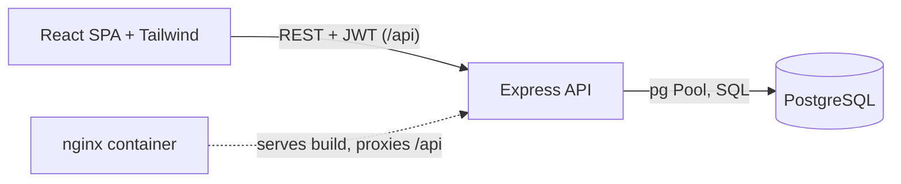
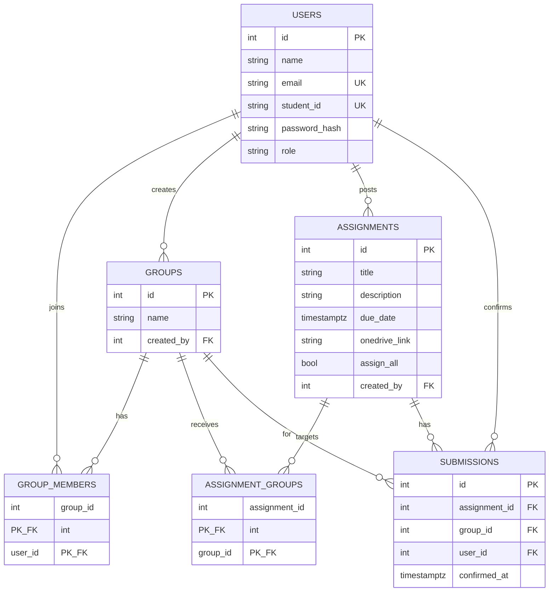

# Joineazy: Student, Group & Assignment Management

Role-based full-stack app. Professors (admin) post assignments with OneDrive links and track progress. Students form groups and confirm submissions through a two-step check.

**Stack:** React + Vite + Tailwind CSS, Node.js + Express, PostgreSQL, JWT auth, Docker.

## Setup

### Docker (recommended)
```bash
docker compose up --build
```
Open http://localhost:3000. Seeded professor login: `prof@joineazy.com` / `admin123`. Students register on the login page.

### Local
```bash
# Backend (needs a running Postgres)
cd backend && cp .env.example .env && npm install && npm run dev
# Frontend
cd frontend && npm install && npm run dev   # http://localhost:5173, /api proxied to :5000
```

## Architecture

Flow: login returns a JWT, stored in localStorage and sent as `Authorization: Bearer`. Middleware verifies it and checks the role. The API reads and writes PostgreSQL. The schema is created on backend start (`backend/db/schema.sql`), and the admin is seeded from env vars.

## Database schema

`SUBMISSIONS` is unique on (assignment, group, user), so each student confirms once per assignment and group. Group progress is confirmed members divided by total members.

## API
All routes except register and login need `Authorization: Bearer <token>`.

| Method | Path | Role | Purpose |
|---|---|---|---|
| POST | /api/auth/register | public | Register a student |
| POST | /api/auth/login | public | Log in, returns token + user |
| GET | /api/auth/me | any | Current user |
| GET | /api/groups | any | Student: own groups. Admin: all groups |
| POST | /api/groups | student | Create group (creator joins) `{name}` |
| POST | /api/groups/:id/members | student | Add member by email or ID `{identifier}` |
| GET | /api/assignments | any | Assignments with per-group progress. Students see only theirs |
| POST | /api/assignments | admin | Create `{title, description, dueDate, onedriveLink, assignAll, groupIds}` |
| PUT | /api/assignments/:id | admin | Edit |
| DELETE | /api/assignments/:id | admin | Delete |
| POST | /api/assignments/:id/confirm | student | Confirm submission `{groupId, confirm:true}` |
| GET | /api/assignments/analytics/summary | admin | Completion counts per assignment |

## Key decisions
- **Admin accounts are seeded, not self-registered**, so nobody can claim the professor role.
- **Two-step confirmation:** the UI asks twice; the API also rejects requests without `confirm: true`.
- **Per-student confirmation** gives student-wise tracking, and group progress comes from the same rows.
- **Authorization lives on the server:** role middleware, plus membership checks when adding members and confirming.
- **Plain SQL with `pg`** keeps queries and the schema easy to explain.
- **Deployment:** three containers. nginx serves the built SPA and proxies `/api` to the backend, so there is no CORS or hard-coded URL in the frontend. Secrets come from environment variables; change `JWT_SECRET` and admin credentials in production.
